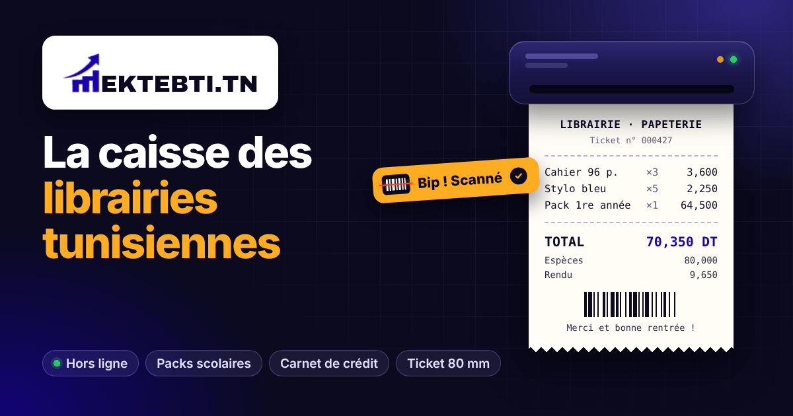
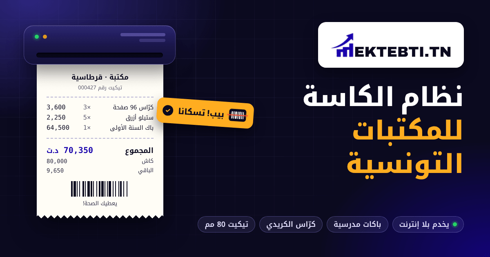

# 06 · Mektebti.tn brand guide (مكتبتي)

Version 1 · 2026-10-15 · Covers the logo, colour, type, graphic devices, tone of voice (FR and Tunisian Arabic) and the web assets in `public/brand/`.

Contrast ratios below were computed with the WCAG 2.x relative-luminance formula [W3]. Pass levels: **4.5:1** for normal text, **3:1** for large text (24 px, or 18.66 px bold) and for icons and other non-text UI [W1][W2]. Items marked **[E]** are my estimates or recommendations, not measurements or sourced facts.

---

## 0. The rules on one screen

1. **Use only the original PNGs** in `public/brand/`. Don't redraw, retype, recolour, stretch or add effects to the logo. You may scale them down, never up.
2. **On light backgrounds**, use `logo-on-light.png`. **On dark backgrounds** (ink, photos, ads), put that same file on a **white plate** (§2.4). **Never put `logo-on-dark.png` on ink or black.** Its blue mark measures **1.52:1** against ink, so it disappears.
3. **Clear space = X** on every side, where X is the height of the "E", about **38 % of the logo's height**.
4. **Minimum sizes:** the full logo **24 px tall** on screen (111 px wide); the mark alone **16 px**; in print, the full logo **25 mm wide**.
5. **Colour roles:** ultramarine **#1800AC** is the logo's colour. Buttons use **#2A12CF**. Amber **#FFAD20** marks the one thing to act on, and always takes **ink text**, never white.
6. **Speak the shop's language:** *caisse, ticket, carnet, packs, rentrée, au millime*. In Arabic: *الكاسة، التيكيت، كرّاس الكريدي، الباكات، العودة المدرسية، بالمليم*.

---

## 1. Asset inventory

### 1.1 Files in `public/brand/`

| File | Pixels | Size | Background | Use |
| --- | --- | --- | --- | --- |
| `logo-on-light.png` *(original)* | 510 × 110 | 10.0 KB | transparent | **Primary logo.** Ink wordmark and blue mark. |
| `logo-on-dark.png` *(original)* | 510 × 110 | 9.9 KB | transparent | White wordmark and blue mark. **Restricted** (§2.2). |
| `mark.png` *(original)* | 97 × 107 | 4.5 KB | transparent | The mark alone, for small UI spots up to 107 px tall. |
| `icon-192.png` / `icon-512.png` *(original)* | 192² / 512² | 11.5 / 50.5 KB | white tile, **transparent corners** | PWA `any` icons |
| **`og-image-fr.png`** *(new)* | **1200 × 630** | **52.4 KB** | opaque, ink | `og:image` / `twitter:image`, FR pages |
| **`og-image-ar.png`** *(new)* | **1200 × 630** | **47.4 KB** | opaque, ink | `og:image` / `twitter:image`, AR pages |
| **`apple-touch-icon.png`** *(new)* | **180 × 180** | **3.5 KB** | **opaque** white | iOS "Add to Home Screen" |
| **`icon-maskable-512.png`** *(new)* | **512 × 512** | **10.7 KB** | **opaque** white | PWA `maskable` icon (Android adaptive) |
| **`favicon-32.png`** *(new)* | **32 × 32** | **1.2 KB** | white rounded tile | Browser tab, high-DPI |
| **`favicon-16.png`** *(new)* | **16 × 16** | **0.5 KB** | white rounded tile | Browser tab, standard DPI |
| **`favicon.ico`** *(new, extra)* | 16 + 32 + 48 | 4.3 KB | white rounded tile | `/favicon.ico` fallback (§1.3) |

<p>


</p>

**How the new files were made** (so they can be redone the same way):

- **The mark is never redrawn.** The large mark comes from `icon-512.png`, the highest-resolution copy we have (about 313 × 343 px of mark, blue on white). It was lifted out with a colour-to-alpha step: each pixel is a blend of #1800AC and white, so the green channel gives its exact coverage. The pixels are the same; only the white is removed. The mark was then downscaled with premultiplied Lanczos.
- **Favicons:** the mark sits on a white rounded tile so it stays visible on dark tab strips. At 16 and 32 px the edge opacity is lifted slightly (alpha gamma 0.7 / 0.85), so the thin arrow shaft still reads as a stroke. The colour stays #1800AC.
- **Maskable icon:** every pixel of the mark is within **37 % of the icon width** from the centre. The safe zone is 40 % [B2], so this leaves a margin.
- **Apple touch icon:** fully opaque. iOS fills transparent pixels in home-screen icons with black [B3][B4]. That is why the existing `icon-192.png`, which has transparent corners, should no longer be the `apple-touch-icon`.
- **OG images:** HTML/CSS rendered in Chromium (Playwright) at 1200 × 630, with the original `logo-on-light.png` on a white plate. Fonts are Inter and Noto Kufi Arabic. The PNGs were then quantised to a 256-colour palette (libimagequant) and compressed with oxipng. Mean error against the unquantised render is under 0.4/255, with no visible banding.
- The build scripts were kept outside the repo, because this task could only write to `public/brand/` and this file. If you want them versioned, add them under `scripts/brand/`.

### 1.2 HTML tags

**Every page (the app shell `index.html` and the static landing pages):**

```html
<link rel="icon" href="/brand/favicon.ico" sizes="48x48">
<link rel="icon" type="image/png" sizes="32x32" href="/brand/favicon-32.png">
<link rel="icon" type="image/png" sizes="16x16" href="/brand/favicon-16.png">
<link rel="apple-touch-icon" sizes="180x180" href="/brand/apple-touch-icon.png">
<link rel="manifest" href="/manifest.webmanifest">
<meta name="theme-color" content="#1800ac">
```

These replace the current `<link rel="icon" href="/favicon.png">` and `<link rel="apple-touch-icon" href="/brand/icon-192.png">`. The old `/favicon.png` is the transparent blue mark: on a dark tab strip (#35363A) it measures **1.06:1**, so it is invisible.

**FR landing (`/decouvrir`).** Crawlers need absolute URLs. Swap the origin when `mektebti.tn` goes live (see doc 04 §2.2).

```html
<meta property="og:image" content="https://libsystem-tn.netlify.app/brand/og-image-fr.png">
<meta property="og:image:type" content="image/png">
<meta property="og:image:width" content="1200">
<meta property="og:image:height" content="630">
<meta property="og:image:alt" content="Mektebti.tn, la caisse des librairies tunisiennes : ticket de caisse et scanner">
<meta name="twitter:card" content="summary_large_image">
<meta name="twitter:image" content="https://libsystem-tn.netlify.app/brand/og-image-fr.png">
```

**AR landing (`/ar/decouvrir`):**

```html
<meta property="og:image" content="https://libsystem-tn.netlify.app/brand/og-image-ar.png">
<meta property="og:image:type" content="image/png">
<meta property="og:image:width" content="1200">
<meta property="og:image:height" content="630">
<meta property="og:image:alt" content="مكتبتي Mektebti.tn، نظام الكاسة للمكتبات التونسية">
<meta name="twitter:card" content="summary_large_image">
<meta name="twitter:image" content="https://libsystem-tn.netlify.app/brand/og-image-ar.png">
```

**Notes on these tags:**

- Doc 04 §2.4 proposed `/og/mektebti-fr-1200x630.png`. Use the `/brand/og-image-*.png` paths above instead, since those files exist.
- Until the landing is prerendered (doc 04 §2.3), crawlers only ever see `index.html`. Put the **FR** OG tags there as the stop-gap. The AR image only works once `/ar/decouvrir` has its own static `<head>`.
- 1200 × 630 is Facebook's recommended size for link images [B1].
- `/brand/*` files are not fingerprinted. If you change an OG image, **give it a new file name** (for example `og-image-fr-v2.png`) and re-scrape the URL in Facebook's Sharing Debugger (https://developers.facebook.com/tools/debug/). Facebook and WhatsApp cache the old image.
- Some apps, WhatsApp among them, may show a small square crop from the centre of the image, which cuts the logo plate **[E]**. The headline still reads in that crop. If a square-first channel matters, make a separate 1:1 card **[E]**.

### 1.3 Manifest and redirects

Proposed `icons` array for `public/manifest.webmanifest`:

```json
"icons": [
  { "src": "/brand/icon-192.png", "sizes": "192x192", "type": "image/png", "purpose": "any" },
  { "src": "/brand/icon-512.png", "sizes": "512x512", "type": "image/png", "purpose": "any" },
  { "src": "/brand/icon-maskable-512.png", "sizes": "512x512", "type": "image/png", "purpose": "maskable" }
]
```

- Keep `any` and `maskable` as **separate entries**. web.dev documents `purpose: "maskable"` on its own entry [B2].
- Drop `/favicon.svg` from the manifest. It is a 16 KB PNG wrapped in an SVG, so it gives no vector benefit.

Browsers request `/favicon.ico` by themselves. Today that path falls through to the SPA rewrite and gets `index.html`. Add this line to `public/_redirects` **above** `/*`:

```
/favicon.ico   /brand/favicon.ico   200
```

---

## 2. The logo

### 2.1 Anatomy

- **The mark:** three rising bars with a growth arrow. The bars also form the **"M"** of MEKTEBTI. It stands for the shop growing, and the stock and sales graph.
- **The wordmark:** "EKTEBTI.TN" in heavy capitals. It is ink #0B0A1F on the light version and white on the dark version. The ".TN" is part of the name: it says Tunisian.
- **The Arabic name مكتبتي is not part of the logo artwork.** When you need it, set it as text (Noto Kufi Arabic 700) outside the clear space, as a caption or in the headline. Never squeeze it inside the clear space.
- **In running text**, write **Mektebti** (FR) or **مكتبتي** (AR). Write **Mektebti.tn** when you mean the brand or website formally. Never type "MEKTEBTI.TN" in a font as a logo substitute. Never write "MekTebti", "Mektebti TN" or "Maktabti".

### 2.2 Versions and where they go

| Version | File | Use it on | Measured contrast |
| --- | --- | --- | --- |
| **Primary** | `logo-on-light.png` | White, paper #F7F7FB, mist #F1F0FF and light photos | Mark **12.85:1** on white, 11.41 on mist. Wordmark 19.49:1. |
| **On dark** | `logo-on-light.png` **on a white plate** (§2.4) | Ink backgrounds, ads, video end cards, busy photos | Same as primary, because it sits on white |
| **Restricted** | `logo-on-dark.png` | Only mid-grey backgrounds (relative luminance about 0.20–0.30, e.g. #8A8A8A: white 3.45:1, mark 3.72:1) | Mark **1.52:1 on ink #0B0A1F**, 1.42:1 on #13112E. **Fails.** |
| **Mark** | `mark.png`, or the icon files | Favicons, app icons, avatars, anywhere narrower than 111 px | 12.85:1 on white |

**Recommendation [E]:** ask whoever drew the logo for the **vector original** (SVG, AI or PDF). With it, a proper **reversed version** can be made: white wordmark plus a mark colour that holds up on ink. Until then, use the white plate and nothing else. Do not make a "white logo" yourself; that is a recolour.

### 2.3 Clear space

**X = the cap height of the wordmark = 0.38 × the logo's height (H).** In the 110 px master, X is 42 px.

Keep at least **1 X** free of text, edges and other graphics on every side. Measure from the artwork, not from the PNG canvas, which has about 1 px of transparent margin.

| Logo height H | 24 px | 32 px | 40 px | 64 px | 110 px |
| --- | --- | --- | --- | --- | --- |
| Clear space X | 9 px | 12 px | 15 px | 24 px | 42 px |

For the **mark alone**, keep clear space of at least **¼ of the mark's height**. Favicons are pixel-fitted and are the only exception.

### 2.4 The white plate (logo on dark backgrounds)

- Pure **#FFFFFF**.
- Padding **≥ 1 X** top and bottom, **≥ 1.25 X** left and right.
- Corner radius **≈ 0.3 H**.
- An optional soft shadow (as in the OG images) is fine. Shadows go on the plate, never on the logo.
- Reference: in the OG images H = 64 px, padding is 24 / 30 px and the radius is 20 px.
- The landing nav already does this: logo-on-light on a white bar.

### 2.5 Minimum and maximum sizes

| Item | Minimum | Notes |
| --- | --- | --- |
| Full logo, screen | **24 px tall** (111 px wide) | Checked by rendering it at 16 to 32 px: below 20 px the bars-as-"M" go muddy. 20 px is the absolute floor in dense UI. Below that, use the mark or the word "Mektebti". |
| Mark, screen | **16 px** | Use the pixel-tuned `favicon-16.png` / `favicon-32.png` tile, not a browser-scaled `mark.png`. |
| Full logo, print | **25 mm wide** **[E]** | |
| Mark, print | **6 mm** **[E]** | |
| **Max print size with today's files (300 dpi)** | Full logo **43 mm** wide (510 px); mark **27 mm** (≈ 320 px from `icon-512`) | Anything larger needs the **vector original**: shop-window sticker, roll-up, flyer header, A4 invoice letterhead. Never upscale the PNGs. |
| Thermal ticket (80 mm) | **Don't print the logo** | Thermal tickets are monochrome, so the blue turns into a grey dither. Instead print an optional, shop-approved text line: « Logiciel : Mektebti.tn ». It costs nothing and refers new shops **[E]**. |

### 2.6 Where the current code breaks these rules

1. **Comparison table header** (`LandingPage.tsx:332`): the logo is 18 px tall, and `landing.css:966-967` forces **10 px on phones**, which cannot be read. Use the mark at ≥ 16 px plus the word "Mektebti", or plain text.
2. **`index.html`:** `apple-touch-icon` points to `icon-192.png`, which has transparent corners and goes black on iOS. The favicon `/favicon.png` is a transparent blue mark that vanishes on dark tabs. Swap both for the tags in §1.2.
3. **Manifest:** there is no maskable icon, so Android has to shrink the `any` icon inside its own launcher shape **[E]**. Add the entry in §1.3.
4. **AR currency:** the app writes **د.ت** (`src/i18n/ar.ts:923`) while the landing mock writes **د** (`copy.ts`). Use **د.ت** everywhere. The AR OG image already does.
5. **French copy:** the landing mock says "Pack 1ère année". The Académie française form is **1re** (and 1er) [B5]. The OG image uses "1re".
6. **Landing mock URL:** it shows `mektebti.tn/caisse`, but ownership of the domain is still unconfirmed (doc 04 §2.2). Change it if the domain is not secured.

---

## 3. Colour

### 3.1 Palette

These tokens come from `src/theme.ts` and `landing.css`.

| Name | Token | Hex | RGB | Role |
| --- | --- | --- | --- | --- |
| Ultramarine (logo) | `brand.800` | **#1800AC** | 24 0 172 | The logo's blue. Headings and totals on light backgrounds. |
| Ultramarine action | `brand.700` (`brand.solid`) | **#2A12CF** | 42 18 207 | Buttons, links, focus. Reads as "the logo" while passing contrast with white. |
| Bright violet | `brand.500` | #5B4BFF | 91 75 255 | Glows and gradients on ink. Large or graphic use only. |
| Lavender | `brand.300` | #A69CFF | 166 156 255 | Lines, grids and secondary text on ink |
| Lavender pale | — | #D6D2FF | 214 210 255 | Chip text on ink (landing kicker) |
| Mist | `brand.50` | #F1F0FF | 241 240 255 | Tinted panels on light backgrounds |
| **Amber** | `accent.400` (`accent.solid`) | **#FFAD20** | 255 173 32 | The call to action and the highlight. **Ink text only.** |
| Amber text | `accent.700` (`accent.fg`) | #B74606 | 183 70 6 | Amber-family **text** on white |
| **Ink** | `ink` | **#0B0A1F** | 11 10 31 | Text, dark backgrounds (never pure #000) |
| Ink 2 | — | #13112E | 19 17 46 | Raised surfaces on ink |
| Paper | — | #F7F7FB | 247 247 251 | Page background |
| Ticket paper | — | #FFFDF6 | 255 253 246 | The ticket device (§5) |
| Line | — | #E7E5F5 | 231 229 245 | Borders. Decorative only (1.24:1 on white). |
| Muted | — | #5D5B7A | 93 91 122 | Secondary text |
| Success | — | #12A150 | 18 161 80 | Success states (icons and large text only) |
| WhatsApp | — | #25D366 | 37 211 102 | **Only** on WhatsApp buttons. It is WhatsApp's colour, not ours. |

**Proportions:**

- **In the product:** about 60 % light neutrals, 30 % ink and ultramarine, **≤ 10 % amber** **[E]**.
- **In dark marketing assets:** an ink field, ultramarine glows, one white object (the plate or ticket) and **one** amber element.

### 3.2 Contrast pairs (measured)

| Foreground on background | Ratio | Verdict |
| --- | --- | --- |
| Ink #0B0A1F on white | 19.49 | AAA, all text |
| Ink on paper #F7F7FB | 18.24 | AAA |
| White on ink | 19.49 | AAA |
| White on #1800AC | 12.85 | AAA |
| White on #2A12CF (buttons) | 10.07 | AAA |
| #1800AC on white / paper / mist | 12.85 / 12.02 / 11.41 | AAA |
| #2A12CF on white | 10.07 | AAA |
| #4029F2 on white | 7.45 | AAA |
| #5B4BFF on white | 5.39 | AA |
| **Ink on amber #FFAD20** | **10.44** | AAA. This is the CTA pairing. |
| Amber on ink | 10.44 | AAA (headline highlight in the OG images) |
| Amber on #1800AC / #2A12CF | 6.88 / 5.39 | AA |
| #B74606 on white | 5.40 | AA text |
| #DD6702 on white | 3.49 | Large text and icons only |
| Muted #5D5B7A on white / paper | 6.48 / 6.06 | AA |
| #D6D2FF on ink | 13.48 | AAA |
| #A69CFF on ink | 8.19 | AAA |
| #5B4BFF on ink | 3.62 | Large text and graphics only |
| #12A150 on white | 3.37 | Large text and icons only |
| **White on amber** | **1.87** | **Fail. Never.** |
| **Amber on white** | **1.87** | **Fail. Never** for text or thin lines. |
| **#1800AC on ink** | **1.52** | **Fail.** This is why logo-on-dark must not go on ink. |
| **#2A12CF on ink** | **1.94** | **Fail.** No blue text on dark; use lavender. |
| **#25D366 on white / white on #25D366** | **1.98** | **Fail** for text. The floating WhatsApp button's white glyph is below 3:1; it relies on its `aria-label` and on everyone knowing the icon. |

### 3.3 Backgrounds and gradients

The dark hero (landing and OG): ink #0B0A1F with two radial glows, `rgba(91,75,255,.38–.42)` at the top corner and `rgba(24,0,172,.5–.62)` at the opposite bottom corner. On top sits a 48 px graph-paper grid in lavender at 7–9 % opacity, masked to fade out.

Keep gradients to ultramarine on ink. **No amber gradients and no rainbow gradients.**

---

## 4. Typography

| Context | Latin | Arabic | Notes |
| --- | --- | --- | --- |
| **Product UI** (app and landing) | `"Segoe UI", system-ui` | `"Noto Kufi Arabic"`, then the system Arabic font | This is the stack in `src/theme.ts`. Noto Kufi Arabic is **not loaded as a web font** in the repo, so on most tills Arabic renders in the OS font. That is fine for speed. To make the landing look the same everywhere, self-host the Arabic subset of Noto Kufi Arabic 700 (≈ 43 KB woff2) for headings only **[E]**. |
| **Marketing** (OG, ads, social, print) | **Inter** 800 / 600 / 400 | **Noto Kufi Arabic** 800 / 700 / 400 | Both are free under the SIL Open Font License [B6][B7]. These are the fonts in the OG images. |
| **Tickets, prices, codes** | Monospace (DejaVu Sans Mono in the mocks) or tabular numerals | Kufi for labels, Western digits for amounts | Amounts line up in columns. |

**Rules:**

- **Headlines:**
  - Latin: Inter 800, tracking −0.035 em, line-height 1.04.
  - Arabic: Kufi 800, tracking 0 (never letter-space Arabic), line-height ≥ 1.25.
- **Small text:** on a 1080 px-wide ad, nothing smaller than **24 px**. On the 1200 × 630 OG image, labels are ≥ 18 px **[E]**.
- **Money is always 3 decimals with a decimal comma.**
  - FR: **70,350 DT** and **1 250,000 DT**, with a narrow no-break space as the thousands separator. This matches `formatMoney` with the `fr-TN` locale.
  - AR: **70,350 د.ت**, with Western digits, as used in Tunisia.
  - For round prices in marketing, you may write **83 DT / mois** or **83 د.ت / الشهر**.
- **French typography:**
  - A no-break space before **; : ! ?** and inside **« »**. In HTML that is `&nbsp;`.
  - **1re / 1er**, **n°**, accented capitals (**É**cole).
- **Arabic:**
  - No italics, no stretched kashida in UI.
  - Write derja in **Arabic script** in official assets. Arabizi (derja in Latin letters) only when replying to someone who wrote in Arabizi **[E]**.
- **Icons:** `lucide-react` line icons (already a dependency) at 1.75–2 px stroke. Don't mix in filled icon sets.

---

## 5. Graphic devices and imagery

**Devices:**

| Device | Spec | Meaning |
| --- | --- | --- |
| **The ticket** | Paper #FFFDF6, zig-zag torn bottom edge, monospace lines, the **total in #1800AC**, a decorative barcode, a thank-you line | The till. This is the product's signature object. |
| **The "Bip !" chip** | Amber #FFAD20 pill with ink text, a small barcode with a red laser line and a check, tilted ±4° | The moment of the scan: speed |
| **Graph paper** | 48 px grid in lavender at 7–9 % on ink | The chart behind the logo's growth arrow |
| **The printer** | Ink-2 gradient body, slot, green and amber LEDs | Hardware included |
| **Chips** | Pill, lavender 10 % fill and 32 % border on ink. A green dot only for "works offline". | Feature tags |
| **Corners** | 16–24 px on cards and plates; full pill on chips and buttons | Friendly and modern |

**Photos** (they follow doc 04 §1.7):

- Real counters in real Tunisian bookshops, with the **shop's written permission**.
- **No customer names or faces** without consent.
- Hands scanning, a ticket coming out, school-pack shelves in September, the owner with a phone.
- Natural light. No stock photos of Western supermarkets.

**Mockups:**

- Show **real flows in TND with 3 decimals** and **real bookshop items**: cahier 96 pages, stylo bleu, pack 1re année, كرّاس، ستيلو، باك.
- Never use a real client's name on a mock ticket without permission. The OG images use the generic "LIBRAIRIE · PAPETERIE" / «مكتبة · قرطاسية».

**RTL:** mirror the **layout** for Arabic (text on the right, visual on the left, as in `og-image-ar.png`). **Never mirror the logo or the mark.** The arrow always rises to the right.

---

## 6. Do / don't

**Do:**

- Use `logo-on-light.png` at or below its native 510 px width.
- Put the logo on a white plate on any dark or busy background.
- Keep the clear space (1 X) and the minimum sizes.
- Ship every asset in **FR and AR**, adapted rather than literally translated.
- Use amber once per view, for the one action that matters.
- Write prices in full: **83 DT / mois**, **70,350 DT**.
- Use the pixel-tuned favicon files for anything smaller than 48 px.

**Don't:**

- Stretch, squash, rotate, crop, outline or recolour the logo. Don't add a shadow or glow to the logo itself.
- Put `logo-on-dark.png` (or any blue mark) straight on ink, black or ultramarine.
- Upscale the PNGs, for example for a roll-up or sticker. Get the vector first.
- Retype "MEKTEBTI.TN" in a font, or rebuild the mark from shapes.
- Put a tagline, QR code or partner logo inside the clear space.
- Mirror the mark for Arabic layouts.
- Use white text on amber, or amber text on white.
- Use blue text (#1800AC or #2A12CF) on ink. Use white or lavender.
- Use the WhatsApp green for anything except WhatsApp.
- Make claims you can't prove, such as « N°1 en Tunisie », « le meilleur », « 500 clients » (§7.4).

---

## 7. Tone of voice

### 7.1 Personality

Mektebti sounds like **a capable neighbour who knows bookshops**: practical, warm, calm and precise to the millime. It is not a tech startup and not a bank.

| We are | We are not |
| --- | --- |
| Concrete: what happens at the counter | Abstract: "solution", "digitalisation", "écosystème" |
| Short: verbs first | Long sentences full of features |
| Reassuring: works offline, we install, a human on WhatsApp | Alarmist or pushy ("Dernière chance !") |
| Respectful: **vous** in FR; polite derja in AR | Over-familiar, or corporate MSA |
| Provable: numbers anyone can check | Superlatives |

### 7.2 Vocabulary

| Say (FR) | Say (AR, derja) | Avoid |
| --- | --- | --- |
| la caisse | الكاسة | POS, terminal de point de vente, نقاط البيع |
| le ticket | التيكيت | reçu thermique |
| le carnet de crédit | كرّاس الكريدي | gestion des créances, الديون |
| les packs scolaires | الباكات المدرسية | kits, bundles |
| la rentrée | العودة المدرسية | back-to-school |
| hors ligne / même sans internet | بلا إنترنت / حتى كي يقصّ الإنترنت | offline-first, PWA |
| sauvegardé en ligne | محفوظ أونلاين | cloud, synchronisation Firestore |
| au millime près | بالمليم | précision décimale |
| encaisser | خلّص | valider la transaction |
| la librairie, la papeterie | المكتبة | le point de vente, le commerce |
| on installe chez vous | نجيو نركّبولك | déploiement, onboarding |

### 7.3 Examples

| | FR | AR |
| --- | --- | --- |
| **Value prop** (as in the OG images) | La caisse des librairies tunisiennes | نظام الكاسة للمكتبات التونسية |
| Speed | Bip, c'est vendu. Le ticket sort. | بيب، تباعت. والتيكيت يطبع. *(landing copy)* |
| Rentrée | La liste de la rentrée en un seul scan. | قائمة العودة المدرسية في سكان واحد. *(landing copy)* |
| Credit | Qui doit combien, depuis quand. | شكون يتسال، قدّاش، ومن وقتاش. *(landing copy)* |
| Offline | Internet coupe ? Vous continuez à vendre. | الإنترنت قصّ؟ تكمّل تبيع عادي. **[to validate]** |
| CTA | Essayer — 1er mois offert | جرّب — الشهر الأول مجاني *(landing copy)* |
| CTA, WhatsApp | Écrivez-nous sur WhatsApp | ابعثلنا على واتساب **[to validate]** |
| **Bad** | « Solution SaaS omnicanale de gestion de point de vente nouvelle génération » | « حلول برمجية متكاملة لإدارة نقاط البيع » |

- Lines marked *(landing copy)* already exist in `src/features/landing/copy.ts`.
- Lines marked **[to validate]** are new. **Have a native Tunisian speaker (the founder or colleague) read every new Arabic line before it ships.** I am not a native derja speaker.

### 7.4 Claims discipline

- **Do claim:**
  - "works without internet"
  - "to the millime"
  - "French and Arabic"
  - "first month free" (while it is true)
  - "already used in bookshops in Tunisia" (true: 2 paying shops today)
- **Don't claim:** rankings ("N°1", "le meilleur", "الأفضل"), client counts we don't have, or legal or fiscal certifications until doc 02 confirms them.
- **"The best solution for bookshops in Tunisia" is our positioning, not a sentence for ads.** Show it with specifics instead: packs scolaires, carnet, offline, millimes.
- **Prices age badly in images.** Keep them **out of the OG images** (they are cached for weeks) and put them in ad text, where they are easy to change. The OG images deliberately show no price.

---

## 8. Checklist before publishing any asset

1. Is it the original logo file, at or below native size, with 1 X clear space?
2. If the background is dark, is the logo on a white plate?
3. Do all text pairs pass §3.2? Is amber used at most once per view?
4. Is there an FR and an AR version, with the AR version mirrored and the logo not mirrored?
5. Is money shown as 3 decimals with DT / د.ت?
6. Is every claim provable? Is there no real client or customer name without permission?
7. Is the file size OK? OG images < 120 KB here (≤ 300 KB is the practitioner limit in doc 04); ad images per platform spec.
8. If an OG image changed, does it have a new file name, and has the URL been re-scraped?

---

## Sources

- [B1] Meta for Developers, *Images in Link Shares*: "Use images that are at least 1200 x 630 pixels"; aspect ratio about 1.91:1. https://developers.facebook.com/docs/sharing/webmasters/images/
- [B2] web.dev, *Adaptive icon support in PWAs with maskable icons*: the safe zone is a centred circle with a radius of 40 % of the icon width; `purpose: "maskable"`. https://web.dev/articles/maskable-icon
- [B3] Apple Developer Forums, thread 713895: "You can't have transparent icons, so the system uses black." https://developer.apple.com/forums/thread/713895
- [B4] makandra cards, *Do not use transparent PNGs for iOS favicons*. https://makandracards.com/makandra/26757-transparent-pngs-ios-favicons
- [B5] Académie française: "premier et première s'abrègent en 1er et 1re". https://www.academie-francaise.fr/abreviations-des-adjectifs-numeraux
- [B6] Inter typeface (SIL Open Font License). https://github.com/rsms/inter
- [B7] Noto Kufi Arabic (SIL Open Font License). https://fonts.google.com/noto/specimen/Noto+Kufi+Arabic
- [W1] WCAG 2.1, SC 1.4.3 Contrast (Minimum). https://www.w3.org/TR/WCAG21/#contrast-minimum
- [W2] WCAG 2.1, SC 1.4.11 Non-text Contrast. https://www.w3.org/TR/WCAG21/#non-text-contrast
- [W3] WCAG 2.1, definition of relative luminance and contrast ratio. https://www.w3.org/TR/WCAG21/#dfn-relative-luminance
